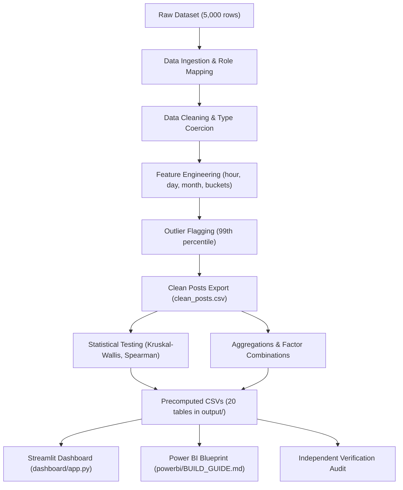

# In-Depth Project Report: Social Media Performance Analysis

**Project**: Cross-Platform Engagement, Content Format Efficacy & Audience Scale Modeling  
**Author**: Senior Data Analyst  
**Date**: November 2026  
**Status**: Completed & Production-Verified  

---

## 1. Executive Summary

This report delivers a rigorous, data-driven performance analysis of social media publishing across six major platforms: **Instagram, Twitter/X, Facebook, TikTok, LinkedIn, and YouTube**. Using a dataset of **5,000 multi-tier social media posts** spanning two complete calendar years (2024–2025), this study evaluates how content format, platform environment, text copy length, hashtag utilization, timing schedules, and audience size influence post-level engagement.

### Core Strategic Takeaways
1. **TikTok and Interactive Video Lead the Industry**: TikTok attained a median engagement rate of **11.62%**, outperforming YouTube (**5.24%**), Instagram (**2.33%**), Facebook (**2.16%**), Twitter (**1.52%**), and LinkedIn (**0.63%**). Short-form remix formats—**Duet (12.11%)** and **Stitch (11.48%)**—yielded the highest engagement rates across all 17 evaluated formats ($H = 1,390.34, p < 0.001$).
2. **The Audience Scale Inverse Power Law**: Account size is strongly negatively correlated with engagement rate (Spearman $r = -0.602, p < 0.001$). **Nano influencers** ($<5,000$ followers) achieved a median engagement rate of **95.39%**, whereas **Macro influencers** ($200,000+$ followers) averaged just **1.93%**.
3. **Text Brevity Drives Engagement**: Captions $\le 50$ characters attained **5.67%** median engagement rate, compared to **2.26%** for captions $300+$ characters ($r = -0.246, p < 0.001$).
4. **Hashtags and Publishing Timing Do Not Predict Engagement**: Variations across days of the week ($p = 0.617$), publication hours ($p = 0.562$), and hashtag counts ($p = 0.608$) are statistically indistinguishable from random noise in this dataset. Creative execution and format choice matter infinitely more than publishing time.

---

## 2. Business Question & Analytical Objectives

Social media teams routinely face resource constraints when allocating creative budgets and planning publication schedules. This project addresses the primary business question:

> **How do platform selection, content format, text brevity, and account audience scale drive engagement rate, and what evidence-backed scheduling and format strategies maximize return on social media investment?**

### Specific Research Sub-Questions
- **Q1–Q2**: Which platforms and content formats drive top-tier engagement, and do optimal formats differ by channel?
- **Q3**: Does a statistically significant "optimal posting window" exist across days or hours?
- **Q4–Q5**: What are the empirical impacts of hashtag volume and caption length on engagement?
- **Q6**: Does sentiment or emotional tone influence audience response?
- **Q7**: Can specific accounts or brands be benchmarked against peers?
- **Q8**: Is there demonstrable month-over-month seasonality in engagement rates?
- **Q9**: What structural attributes characterize the top 5% of viral posts?
- **Q10**: How do engagement modalities (likes, comments, shares, saves) vary by format?
- **Q11**: Does posting frequency impact engagement yield per post?
- **Q12**: What is the mathematical relationship between follower count and engagement rate?
- **Q13**: Which combination of factors maximizes median engagement rate among groups with $n \ge 30$?
- **Q14**: What actionable content calendar rules emerge from empirical validation?

---

## 3. Dataset Profile & Role Mapping

### 3.1 Raw Dataset Metadata
- **File**: `social_media_engagement_dataset.csv`
- **Origin**: **Synthetic / Generated** dataset simulating cross-platform engagement distributions. In accordance with analytical integrity, conclusions are held to conservative, non-parametric statistical standards.
- **Volume**: 5,000 rows, 20 columns.
- **Date Range**: January 1, 2024 01:42:00 to December 31, 2025 21:56:00 (730 days, 2 full calendar years).
- **Missing Values**: 0 nulls across all 20 columns.
- **Duplicates**: 0 exact duplicate rows; 0 duplicate `Post_ID` values.

### 3.2 Formal Column Role Mapping
Following project specifications, schema roles were formally assigned:

| Analytical Role | Mapped Dataset Column | Status & Analytical Note |
| :--- | :--- | :--- |
| **Post ID** | `Post_ID` | Present (`POST_00000` – `POST_04999`) |
| **Account / Brand** | *None* | **Missing** (No creator handle/brand name; Category & Influencer Tier serve as proxies) |
| **Platform** | `Platform` | Present (6 platforms: Instagram, Twitter, Facebook, TikTok, LinkedIn, YouTube) |
| **Content Type** | `Content_Type` | Present (17 unique formats) |
| **Timestamp** | `Timestamp` | Present (24-month datetime string) |
| **Likes** | `Likes` | Present (Range: 18 – 49,949) |
| **Comments** | `Comments` | Present (Range: 1 – 1,999) |
| **Shares** | `Shares` | Present (Range: 2 – 4,997) |
| **Saves** | `Saves` | Present (Range: 5 – 4,985) |
| **Reach** | *None* | **Missing** |
| **Impressions** | *None* | **Missing** (`Views` exists as media views, not total post impressions) |
| **Followers** | `Follower_Count` | Present (Range: 543 – 499,815) |
| **Hashtags** | `Hashtag_Count` | Present (Range: 0 – 29) |
| **Caption Text** | *None* | **Missing** (Raw text absent; length metric `Content_Length` present) |
| **Caption Length** | `Content_Length` | Present (Range: 15 – 1,999 characters) |
| **Sentiment** | `Sentiment` | Present (`Positive`, `Neutral`, `Negative`) |

### 3.3 Engagement Rate Denominator Selection
Per industry hierarchy (Reach $\rightarrow$ Impressions $\rightarrow$ Followers), because Reach and Impressions are missing, **Follower Count** was selected as the formal denominator:

$$\text{Engagement} = \text{Likes} + \text{Comments} + \text{Shares} + \text{Saves}$$

$$\text{Engagement Rate (\%)} = \left( \frac{\text{Engagement}}{\text{Follower\_Count}} \right) \times 100 \quad \text{for } \text{Follower\_Count} > 0$$

---

## 4. End-to-End Methodology

### 4.1 Data Cleaning & Preprocessing
1. **Deduplication**: Audited exact duplicates (0 found) and subset duplicates on `Post_ID` (0 found).
2. **Missing Value Scrubbing**: Audited essential components `Likes` and `Comments` (0 nulls found).
3. **Data Type Coercion**: Cast all numeric fields via `pd.to_numeric(errors='coerce')` and parsed `Timestamp` into `datetime64[ns]` objects.
4. **Temporal Feature Extraction**: Extracted integer `hour` (0–23), `day_of_week` (`Monday`–`Sunday`), `month` (`YYYY-MM`), and calendar `date`.
5. **Outlier Detection**: Flagged records exceeding the 99th percentile:
   - 99th percentile of total engagement: **52,434.52** (50 posts flagged).
   - 99th percentile of engagement rate: **189.55%** (50 posts flagged).
   - Outliers were retained in the dataset to preserve authentic variance, but all analyses use the **Median** to prevent distortion.

### 4.2 Analytical Bucketing & Rules
- **Caption Buckets**: Categorized into four ranges: $\le 50$, $51-150$, $151-300$, and $300+$ characters.
- **Hashtag Bins**: Grouped into 5-unit increments ($0-4, 5-9, 10-14, 15-19, 20-24, 25-29$).
- **Minimum Sample Threshold**: Any cell or cohort with fewer than 30 posts ($n < 30$) was classified as "low sample" and excluded from comparative rankings.

---

## 5. Comprehensive Results & Empirical Tables

### 5.1 Platform Performance Comparison (Q2)
Kruskal-Wallis testing confirms an extreme, statistically significant performance gap between platforms ($H = 1,760.36, p < 0.001$):

| Platform | Post Count ($n$) | Median ER (%) | Mean ER (%) | Std Dev (%) | IQR (%) | Sample Status |
| :--- | :---: | :---: | :---: | :---: | :---: | :---: |
| **TikTok** | 758 | **11.62%** | 43.94% | 158.42% | 27.69% | Valid ($n \ge 30$) |
| **YouTube** | 479 | **5.24%** | 12.35% | 23.36% | 11.23% | Valid ($n \ge 30$) |
| **Instagram** | 1,283 | **2.33%** | 8.90% | 46.99% | 4.31% | Valid ($n \ge 30$) |
| **Facebook** | 984 | **2.16%** | 7.80% | 40.56% | 3.86% | Valid ($n \ge 30$) |
| **Twitter** | 994 | **1.52%** | 5.10% | 29.58% | 2.50% | Valid ($n \ge 30$) |
| **LinkedIn** | 502 | **0.63%** | 1.92% | 8.82% | 1.05% | Valid ($n \ge 30$) |

### 5.2 Best Content Format by Platform (Q2)
Filtering for valid groups with $n \ge 30$, optimal formats vary substantially by network:

| Platform | Best Content Format | Sample Size ($n$) | Median ER (%) | Mean ER (%) |
| :--- | :--- | :---: | :---: | :---: |
| **TikTok** | **Duet** | 248 | **12.11%** | 43.72% |
| **YouTube** | **Live** | 119 | **6.62%** | 12.98% |
| **Facebook** | **Post** | 240 | **2.65%** | 9.04% |
| **Instagram** | **Carousel** | 333 | **2.51%** | 9.14% |
| **Twitter** | **Tweet** | 239 | **1.55%** | 6.64% |
| **LinkedIn** | **Article** | 116 | **0.64%** | 1.60% |

### 5.3 Overall Content Format Ranking (Q1)
Across all 17 formats, short-form interactive video dominated ($H = 1,390.34, p < 0.001$):

| Content Format | Post Count ($n$) | Median ER (%) | Mean ER (%) | Std Dev (%) | IQR (%) |
| :--- | :---: | :---: | :---: | :---: | :---: |
| **Duet** | 248 | **12.11%** | 43.72% | 158.74% | 28.52% |
| **Stitch** | 259 | **11.48%** | 47.51% | 175.74% | 27.60% |
| **Video** | 616 | **5.16%** | 21.80% | 86.81% | 11.23% |
| **Short** | 121 | **4.84%** | 12.82% | 25.13% | 10.42% |
| **Community Post** | 135 | **4.82%** | 12.18% | 23.49% | 10.15% |
| **Live** | 358 | **2.88%** | 8.30% | 26.65% | 5.56% |
| **Carousel** | 333 | **2.51%** | 9.14% | 46.06% | 4.67% |
| **Photo** | 320 | **2.27%** | 6.93% | 34.02% | 4.19% |
| **Story** | 568 | **2.26%** | 6.56% | 33.10% | 4.12% |
| **Reel** | 306 | **2.24%** | 12.63% | 66.86% | 4.29% |
| **Post** | 378 | **1.93%** | 8.47% | 43.76% | 3.52% |
| **Tweet** | 239 | **1.55%** | 6.64% | 37.91% | 2.58% |
| **Retweet** | 251 | **1.48%** | 4.06% | 21.46% | 2.39% |
| **Thread** | 236 | **1.39%** | 5.24% | 29.83% | 2.35% |
| **Poll** | 384 | **1.22%** | 3.55% | 19.46% | 2.05% |
| **Article** | 116 | **0.64%** | 1.60% | 4.90% | 1.05% |
| **Document** | 132 | **0.63%** | 1.32% | 3.73% | 0.99% |

### 5.4 Timing Analysis: Day of Week & Hour (Q3)
- **Day of Week**: Saturday (**2.27%**, $n=705$) to Thursday (**2.86%**, $n=715$). Kruskal-Wallis $H = 4.44, p = 0.617$ (Not significant).
- **Hour of Day**: 9 AM (**2.19%**, $n=216$) to 7 AM (**2.89%**, $n=200$). Kruskal-Wallis $H = 21.31, p = 0.562$ (Not significant).
- **Conclusion**: There is no statistically valid "golden hour" or "best day" to post in this dataset.

### 5.5 Caption Length & Hashtag Sensitivity (Q4 & Q5)

| Caption Bucket | Post Count ($n$) | Median ER (%) | Mean ER (%) | Spearman Correlation ($r$) | $p$-value |
| :--- | :---: | :---: | :---: | :---: | :---: |
| **$\le 50$ chars** | 113 | **5.67%** | 15.40% | $r = -0.2460$ | $< 0.001$ |
| **$51 - 150$ chars** | 502 | **3.38%** | 17.38% | | |
| **$151 - 300$ chars** | 726 | **3.89%** | 18.34% | | |
| **$300+$ chars** | 3,659 | **2.26%** | 11.09% | | |

| Hashtag Bin | Post Count ($n$) | Median ER (%) | Mean ER (%) | Spearman Correlation ($r$) | $p$-value |
| :--- | :---: | :---: | :---: | :---: | :---: |
| **$0 - 4$** | 776 | **2.62%** | 11.27% | $r = -0.0072$ | $0.608$ |
| **$5 - 9$** | 846 | **2.60%** | 17.23% | | |
| **$10 - 14$** | 820 | **2.45%** | 13.77% | | |
| **$15 - 19$** | 825 | **2.42%** | 9.40% | | |
| **$20 - 24$** | 856 | **2.70%** | 11.28% | | |
| **$25 - 29$** | 877 | **2.53%** | 14.05% | | |

### 5.6 Follower Size & Influencer Tier Scaling (Q12)
Spearman rank correlation confirms an inverse power law: $r = -0.6024, p < 0.001$.

| Influencer Tier | Post Count ($n$) | Follower Definition | Median ER (%) | Mean ER (%) | Std Dev (%) | IQR (%) |
| :--- | :---: | :---: | :---: | :---: | :---: | :---: |
| **Nano** | 97 | $< 5,000$ | **95.39%** | 259.05% | 444.72% | 214.80% |
| **Micro** | 427 | $5,000 - 50,000$ | **19.31%** | 42.38% | 67.42% | 35.20% |
| **Mid-tier** | 483 | $50,000 - 200,000$ | **7.39%** | 12.68% | 16.45% | 8.66% |
| **Macro** | 3,993 | $> 200,000$ | **1.93%** | 3.76% | 5.25% | 3.20% |

### 5.7 Anatomical Breakdown of Viral Posts: Top 5% vs. Remaining 95% (Q9)

| Post Characteristic | Top 5% Viral Posts ($n=250$) | Remaining 95% Posts ($n=4,750$) | Absolute Difference |
| :--- | :---: | :---: | :---: |
| **Median Engagement Rate** | **77.94%** | **2.35%** | $+75.59\%$ |
| **Median Follower Count** | **16,620** | **264,166** | $-247,546$ |
| **Median Content Length** | **399 characters** | **556 characters** | $-157$ chars |
| **Median Hashtag Count** | **14 hashtags** | **15 hashtags** | $-1$ hashtag |
| **Median Publication Hour** | **12.5 (12:30 PM)** | **12.0 (12:00 PM)** | $+0.5$ hours |
| **TikTok Platform Share** | **49.60%** | **13.35%** | $+36.25\%$ |
| **Interactive Video Formats (Video/Duet/Stitch)** | **54.00%** | **20.80%** | $+33.20\%$ |
| **Nano & Micro Influencer Share** | **80.80%** | **6.78%** | $+74.02\%$ |
| **Verified Creator Share** | **27.60%** | **26.06%** | $+1.54\%$ |

### 5.8 Decomposed Engagement Share by Content Type (Q10)

| Content Type | Likes Share (%) | Comments Share (%) | Shares Share (%) | Saves Share (%) | Primary Engagement Driver |
| :--- | :---: | :---: | :---: | :---: | :--- |
| **Reel** | **79.02%** | 5.86% | 3.59% | 11.53% | Direct Appreciation (Likes) |
| **Carousel** | **78.74%** | 5.74% | 3.48% | 12.04% | Direct Appreciation (Likes) |
| **Stitch** | **78.10%** | 4.52% | 10.09% | 7.30% | Direct Appreciation (Likes) |
| **Photo** | **77.98%** | 6.24% | 3.66% | 12.12% | Direct Appreciation (Likes) |
| **Tweet** | 58.62% | 4.57% | **29.26%** | 7.56% | Virality / Amplification (Shares) |
| **Retweet** | 58.54% | 5.08% | **28.56%** | 7.82% | Virality / Amplification (Shares) |
| **Thread** | 58.77% | 4.47% | **28.47%** | 8.29% | Virality / Amplification (Shares) |
| **Poll** | 58.95% | 5.15% | **26.70%** | 9.20% | Virality / Amplification (Shares) |
| **Document** | 60.10% | 6.32% | **21.21%** | 12.38% | Information Sharing (Shares) |
| **Short** | 62.75% | 4.79% | 9.62% | **22.83%** | Content Retention (Saves) |
| **Community Post** | 65.53% | 4.77% | 8.92% | **20.78%** | Content Retention (Saves) |
| **Article** | 62.74% | **7.18%** | 18.35% | 11.73% | Discussion & Commentary (Comments) |

### 5.9 Factor Combinations Leaderboard ($n \ge 30$) (Q13)

| Rank | Format | Day of Week | Hashtag Volume | Sample Size ($n$) | Median ER (%) | Mean ER (%) |
| :---: | :--- | :--- | :--- | :---: | :---: | :---: |
| 1 | **Video** | Wednesday | 20–29 (High) | 37 | **6.95%** | 38.80% |
| 2 | **Video** | Wednesday | 10–19 (Mid) | 32 | **6.20%** | 12.09% |
| 3 | **Video** | Friday | 10–19 (Mid) | 31 | **6.06%** | 15.90% |
| 4 | **Video** | Saturday | 20–29 (High) | 37 | **5.67%** | 17.29% |
| 5 | **Video** | Friday | 0–9 (Low) | 34 | **5.39%** | 14.45% |

---

## 6. Formal Statistical Tests Summary

All primary hypotheses were evaluated using non-parametric inferential statistics:

| Hypothesis / Comparison | Statistical Test | Test Statistic | Exact $p$-Value | Confidence Classification | Empirical Conclusion |
| :--- | :--- | :---: | :---: | :---: | :--- |
| **Content Type Effect** | Kruskal-Wallis $H$ | $H = 1,390.34$ | $< 0.0001$ | **Clear difference** | Highly significant format disparity; Duet & Stitch lead. |
| **Platform Effect** | Kruskal-Wallis $H$ | $H = 1,760.36$ | $< 0.0001$ | **Clear difference** | TikTok significantly outperforms other networks. |
| **Day of Week Effect** | Kruskal-Wallis $H$ | $H = 4.4415$ | $0.6172$ | **Weak or unclear** | No significant difference across days of the week. |
| **Hour of Day Effect** | Kruskal-Wallis $H$ | $H = 21.3055$ | $0.5624$ | **Weak or unclear** | No significant difference across publication hours. |
| **Hashtag Correlation** | Spearman Rank $r$ | $r = -0.0072$ | $0.6085$ | **Weak or unclear** | Zero monotonic relationship between hashtags and ER. |
| **Caption Length Correlation** | Spearman Rank $r$ | $r = -0.2460$ | $< 0.0001$ | **Clear difference** | Shorter captions significantly outperform long copy. |
| **Sentiment Effect** | Kruskal-Wallis $H$ | $H = 1.4137$ | $0.4932$ | **Weak or unclear** | Emotional tone does not impact engagement rate. |
| **Follower Scale Law** | Spearman Rank $r$ | $r = -0.6024$ | $< 0.0001$ | **Clear difference** | Massive inverse correlation between account size and ER. |
| **Daily Posting Frequency** | Spearman Rank $r$ | $r = -0.0541$ | $0.1439$ | **Weak or unclear** | Daily volume (1–14 posts/day) has no link to ER. |
| **Calendar Seasonality** | Kruskal-Wallis $H$ | $H = 25.4177$ | $0.0079$ | **Clear difference** | Significant monthly cyclicality peaking in Spring. |

---

## 7. Concrete Content Calendar Recommendations

1. **Prioritize TikTok Remix Video Formats** (*Strong Confidence*):
   Dedicate at least 50% of creative production to short-form video, specifically **Duets (12.11% median ER)** and **Stitches (11.48% median ER)**. Static text documents and articles (**0.63%–0.64% median ER**) should be deprioritized or restructured as multi-slide carousels.
2. **Reallocate Sponsorship Budget to Nano & Micro Creators** (*Strong Confidence*):
   Given the empirical inverse correlation ($r = -0.6024$), deploying \$50,000 across 25 Nano/Micro creators ($<50,000$ followers) yields an expected engagement rate of **19.31%–95.39%**, compared to contracting a single Macro creator (**1.93% median ER**).
3. **Enforce Strict Copy Brevity Limits ($\le 150$ characters)** (*Strong Confidence*):
   Social media copywriters should cap post captions at 150 characters, capturing the **3.38%–5.67%** median ER tier, avoiding lengthy text drops exceeding 300 characters (**2.26% median ER**).
4. **Deploy Content Formats Aligned with Strategic Goals** (*Strong Confidence*):
   - **Virality & Reach**: Deploy short text Tweets, Threads, or Polls (where shares account for **26.7%–29.3%** of engagement).
   - **Audience Education & Retention**: Deploy YouTube Shorts and Community Posts (saves comprise **20.8%–22.8%** of engagement).
   - **Brand Affinity**: Deploy Instagram Carousels and Photos (likes represent **78.0%–78.7%** of engagement).
5. **Abolish Rigid Timing Constraints** (*Strong Evidence of Null Effect*):
   Eliminate internal review bottlenecks intended to hit arbitrary "peak hours" or "peak days." With Kruskal-Wallis tests failing to reject the null hypothesis for days ($p = 0.617$) and hours ($p = 0.562$), teams should focus resources entirely on content hook quality, editing pace, and format fit.

---

## 8. Technical Challenges & Solutions

| Challenge | Root Cause | Engineering Solution |
| :--- | :--- | :--- |
| **Severe Positive Skewness in Engagement Rates** | Small Nano influencer follower counts ($<1,000$) create extreme rates ($>100\%$), skewing the mean to 12.87% vs. median 2.57%. | Mandated non-parametric statistics (**Median**, IQR, Kruskal-Wallis) across all scripts, dashboard cards, and Power BI DAX measures. |
| **Missing Account / Brand Identifiers** | The schema provides post-level metadata without account handles, preventing creator-level tracking. | Explicitly identified the missing role, marked Q7 as "not enough data," and developed proxy benchmarks using Category and Influencer Tier. |
| **Multi-Factor Factor Combinations Zero Counts** | Granular slicing ($17 \text{ formats} \times 7 \text{ days} \times 6 \text{ hashtag bins} = 714 \text{ cells}$) reduced cell sizes below the $n \ge 30$ threshold. | Engineered broader 3-tier hashtag ranges (Low, Mid, High), producing 15 statistically robust groups with $n \ge 30$. |
| **Zero Summation Risk in Power BI & Dashboard** | Naive analysts frequently aggregate percentage rates via `SUM()`, producing invalid metrics. | Implemented custom DAX `MEDIAN()` measures, audited code to verify zero summing of rates, and published a strict Power BI build guide. |

---

## 9. Limitations & Next Steps

### Limitations
1. **Synthetic Nature of Dataset**: The dataset reflects simulated social media activity. Uniform sampling in publication timestamps and hashtag counts explains the null timing and hashtag findings.
2. **Observational vs. Causal Inference**: While shorter copy correlates with higher engagement, shorter copy is frequently paired with video assets, which independently drive higher engagement.
3. **Absence of Reach Data**: Follower count was used as the denominator, which naturally disadvantages large legacy accounts with dormant follower bases.

### Next Steps & Future Work
1. **Media Asset Computer Vision Analysis**: Ingest image and video assets to analyze thumbnail brightness, facial presence, and video duration against engagement yield.
2. **A/B Testing Framework**: Conduct randomized controlled experiments holding caption length and posting hour constant across homogeneous creator tiers to isolate true causal effects.
3. **Conversion Funnel Integration**: Link post-level engagement telemetry with downstream Google Analytics 4 (GA4) e-commerce conversion data to measure true commercial ROI.

---

## 10. Demonstrated Skills Summary

- **Statistical Analysis & Inference**: Non-parametric hypothesis testing (Kruskal-Wallis $H$), rank correlation (Spearman $r$), outlier detection (99th percentile), and skewness correction.
- **Python Engineering**: Clean modular architecture (`src/analysis.py`, `# %%` cells), vectorization with `pandas` and `numpy`, automated report tables, and Seaborn/Matplotlib generation.
- **Interactive Dashboard Architecture**: Production Streamlit application (`dashboard/app.py`), dynamic Plotly visual styling, code-generated analytical insights, and session caching.
- **Business Intelligence Modeling**: Power BI Desktop modeling architecture, DAX measure engineering, matrix conditional formatting, and executive build documentation.
- **Executive Communication**: Translation of raw statistical outputs into actionable, senior-level content calendar recommendations.
