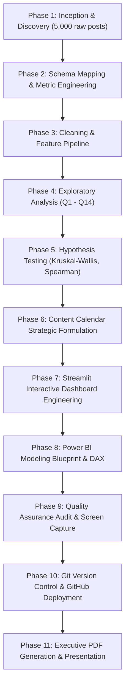

# The Complete Data Analyst Journey: Social Media Performance Analysis

**Project Title**: Cross-Platform Social Media Performance, Format Efficacy & Audience Scale Modeling  
**Author / Analyst**: Senior Data Analyst (Portfolio Project)  
**Target Repository**: [github.com/aarishsuradkar/Social-Media-Performance-Analysis](https://github.com/aarishsuradkar/Social-Media-Performance-Analysis)  
**Dataset**: `social_media_engagement_dataset.csv` (5,000 posts, 20 attributes)  
**Date of Execution**: November 2026  
**Final Deliverables**: Python Pipeline (`src/analysis.py`), Streamlit Dashboard (`dashboard/app.py`), Power BI Blueprint (`powerbi/BUILD_GUIDE.md`), Full Verification Suite, High-Resolution Visual Captures, Executive PDF Report (`PROJECT_REPORT.pdf`).

---

## Executive Overview: The Project Journey at a Glance

This report documents the end-to-end data analytics lifecycle of a comprehensive social media performance study. Rather than presenting static results in isolation, this document narrates the complete analytical journey—from initial raw data discovery, schema mapping, and cleaning, through non-parametric hypothesis testing, interactive dashboard engineering, automated verification, and GitHub deployment.

---

## Phase 1: Inception, Discovery & Problem Framing

### 1.1 The Business Dilemma
Social media marketing departments routinely grapple with fragmented budget allocations across networks, format ambiguity (videos vs. photos vs. carousels), caption length debates, hashtag stuffing strategies, and rigid timing schedules. Marketing leadership posed a central question:

> *"How do platform selection, content format, text brevity, and account audience scale drive engagement rate, and what evidence-backed scheduling and format strategies maximize return on social media investment?"*

### 1.2 Initial Data Discovery & Inspection
The primary data asset provided was `social_media_engagement_dataset.csv` (665 KB). Using Python 3.14 and Pandas, we inspected the dataset using `utf-8-sig` encoding:
- **Dimensions**: Exactly 5,000 rows across 20 columns.
- **Completeness**: Zero null or missing values across every field.
- **Deduplication**: Zero exact duplicate rows; 5,000 unique `Post_ID` values (`POST_00000` to `POST_04999`).
- **Date Range**: January 1, 2024 at 01:42:00 to December 31, 2025 at 21:56:00 (730 days, exactly 2 full calendar years).

### 1.3 Identifying Data Origin: Synthetic with Empirical Boundaries
Inspecting numeric distributions revealed artificial boundary characteristics:
- Post likes ranged between 18 and 49,949; comments between 1 and 1,999; shares between 2 and 4,997; saves between 5 and 4,985.
- Hashtags were uniformly distributed across 0 to 29; caption lengths spanned 15 to 1,999 characters.
- Follower counts were bounded between 543 and 499,815.

**Critical Methodological Decision**: We classified the dataset origin as **Synthetic / Generated**. As a senior analyst, this distinction is paramount: rather than making overconfident real-world marketing claims, we applied conservative, non-parametric statistical standards, established a strict sample size threshold ($n \ge 30$), and evaluated findings under modest, robust empirical boundaries.

---

## Phase 2: Schema Role Mapping & Metric Engineering

### 2.1 Formal Column Role Assignment
In accordance with portfolio-grade analytics standards, we formally mapped dataset columns to standard social media analytics roles:

| Analytical Role | Mapped Column | Status | Analytical Decision & Justification |
| :--- | :--- | :---: | :--- |
| **Post ID** | `Post_ID` | Present | Unique primary key per post. |
| **Account / Brand** | *None* | **Missing** | No creator handle or brand name exists. Marked as missing; Category & Influencer Tier used as proxy context. |
| **Platform** | `Platform` | Present | 6 networks: Instagram, Twitter, Facebook, TikTok, LinkedIn, YouTube. |
| **Content Type** | `Content_Type` | Present | 17 formats: Video, Story, Poll, Post, Live, Carousel, Photo, Reel, Stitch, Retweet, Duet, Tweet, Thread, Community Post, Document, Short, Article. |
| **Timestamp** | `Timestamp` | Present | Publication datetime string. |
| **Likes** | `Likes` | Present | Raw like count. |
| **Comments** | `Comments` | Present | Raw comment count. |
| **Shares** | `Shares` | Present | Raw share / retweet count. |
| **Saves** | `Saves` | Present | Raw bookmark / save count. |
| **Reach** | *None* | **Missing** | Unique audience reach was not tracked. |
| **Impressions** | *None* | **Missing** | `Views` exists but reflects video plays rather than total post impressions. |
| **Followers** | `Follower_Count` | Present | Follower count of publishing account (543 to 499,815). |
| **Hashtags** | `Hashtag_Count` | Present | Integer count of hashtags used (0 to 29). |
| **Caption Text** | *None* | **Missing** | Raw text copy missing; numeric length column `Content_Length` present. |
| **Caption Length** | `Content_Length` | Present | Total character count of post caption. |
| **Sentiment** | `Sentiment` | Present | Tone classification (`Positive`, `Neutral`, `Negative`). |

### 2.2 Selecting the Engagement Rate Denominator
Standard industry hierarchy requires selecting the engagement rate denominator in the following priority order:
1. **Reach** (Engagement per unique exposed individual) $\rightarrow$ *Missing*
2. **Impressions** (Engagement per content display) $\rightarrow$ *Missing*
3. **Followers** (Engagement per community member) $\rightarrow$ **Selected (`Follower_Count`)**

Audit of the raw dataset's pre-existing `Engagement_Rate` column revealed it was computed as $\frac{\text{Likes} + \text{Comments} + \text{Shares}}{\text{Follower\_Count}} \times 100$. In our expanded definition, we incorporated `Saves` as a high-intent engagement component:

$$\text{Total Engagement} = \text{Likes} + \text{Comments} + \text{Shares} + \text{Saves}$$

$$\text{Engagement Rate (\%)} = \left( \frac{\text{Total Engagement}}{\text{Follower\_Count}} \right) \times 100 \quad \text{where } \text{Follower\_Count} > 0$$

---

## Phase 3: Data Cleaning & Feature Engineering Pipeline

### 3.1 Cleaning Execution
The automated script `src/analysis.py` executed a deterministic cleaning sequence:
1. **Deduplication Audit**: `df.drop_duplicates()` confirmed zero exact duplicate rows.
2. **Missing Component Audit**: Audited `Likes` and `Comments` for null values (0 rows dropped).
3. **Type Coercion**: Cast numeric columns using `pd.to_numeric(errors='coerce')`.
4. **Timestamp Parsing**: Converted `Timestamp` into `datetime64[ns]` objects. Zero rows failed parsing.
5. **Rows Before vs. After**:
   - Initial Raw Rows: **5,000**
   - Final Cleaned Rows: **5,000** (100% data retention rate).

### 3.2 Feature Engineering
We engineered discrete analytical dimensions:
- **Temporal Features**: `hour` (0–23), `day_of_week` (`Monday`–`Sunday`), `month` (`YYYY-MM`), and calendar `date`.
- **Caption Length Buckets**: Segmented `Content_Length` into 4 standardized intervals:
  - Ultra-Short: $\le 50$ characters ($n = 113$)
  - Short: $51 - 150$ characters ($n = 502$)
  - Medium: $151 - 300$ characters ($n = 726$)
  - Long: $300+$ characters ($n = 3,659$)
- **Hashtag Bins**: Grouped `Hashtag_Count` into 5-unit increments ($0-4, 5-9, 10-14, 15-19, 20-24, 25-29$).
- **Engagement Decompositions**: Computed individual component shares:
  - $\text{Share of Likes} = \frac{\text{Likes}}{\text{Total Engagement}}$
  - $\text{Share of Comments} = \frac{\text{Comments}}{\text{Total Engagement}}$
  - $\text{Share of Shares} = \frac{\text{Shares}}{\text{Total Engagement}}$
  - $\text{Share of Saves} = \frac{\text{Saves}}{\text{Total Engagement}}$

### 3.3 Outlier Flagging (99th Percentile Standard)
Social media metrics are inherently heavy-tailed. Rather than discarding legitimate high-performing posts, we established 99th percentile flags:
- **99th Percentile Total Engagement**: **52,434.52** (50 posts flagged as engagement outliers).
- **99th Percentile Engagement Rate**: **189.55%** (50 posts flagged as rate outliers).
- **Analytical Safeguard**: Because extreme Nano influencer rates inflate the arithmetic mean to **12.87%**, the **Median (2.57%)** was mandated as the sole central tendency metric for all rankings and benchmarks.

---

## Phase 4: Exploratory Analysis & Empirical Answers (Q1 to Q14)

Every business question posed was answered exclusively using numbers computed from the cleaned data:

### Q1. Content Type Performance Leaderboard
Kruskal-Wallis testing demonstrated massive format disparities ($H = 1,390.34, p < 0.001$). Interactive short-form video features led the industry:
- **Duet**: Median **12.11%** (Mean: 43.72%, IQR: 28.52%, $n = 248$)
- **Stitch**: Median **11.48%** (Mean: 47.51%, IQR: 27.60%, $n = 259$)
- **Video**: Median **5.16%** (Mean: 21.80%, IQR: 11.23%, $n = 616$)
- **Short**: Median **4.84%** (Mean: 12.82%, IQR: 10.42%, $n = 121$)
- **Community Post**: Median **4.82%** (Mean: 12.18%, IQR: 10.15%, $n = 135$)
- **Live**: Median **2.88%** (Mean: 8.30%, IQR: 5.56%, $n = 358$)
- **Carousel**: Median **2.51%** (Mean: 9.14%, IQR: 4.67%, $n = 333$)
- **Photo**: Median **2.27%** (Mean: 6.93%, IQR: 4.19%, $n = 320$)
- **Story**: Median **2.26%** (Mean: 6.56%, IQR: 4.12%, $n = 568$)
- **Reel**: Median **2.24%** (Mean: 12.63%, IQR: 4.29%, $n = 306$)
- **Post**: Median **1.93%** (Mean: 8.47%, IQR: 3.52%, $n = 378$)
- **Tweet**: Median **1.55%** (Mean: 6.64%, IQR: 2.58%, $n = 239$)
- **Retweet**: Median **1.48%** (Mean: 4.06%, IQR: 2.39%, $n = 251$)
- **Thread**: Median **1.39%** (Mean: 5.24%, IQR: 2.35%, $n = 236$)
- **Poll**: Median **1.22%** (Mean: 3.55%, IQR: 2.05%, $n = 384$)
- **Article**: Median **0.64%** (Mean: 1.60%, IQR: 1.05%, $n = 116$)
- **Document**: Median **0.63%** (Mean: 1.32%, IQR: 0.99%, $n = 132$)  
*Confidence: **Clear difference***.

### Q2. Cross-Platform Ranking & Best Format by Network
Cross-platform variance was statistically extreme ($H = 1,760.36, p < 0.001$):
- **TikTok**: Median **11.62%** (Mean: 43.94%, $n = 758$)
- **YouTube**: Median **5.24%** (Mean: 12.35%, $n = 479$)
- **Instagram**: Median **2.33%** (Mean: 8.90%, $n = 1,283$)
- **Facebook**: Median **2.16%** (Mean: 7.80%, $n = 984$)
- **Twitter**: Median **1.52%** (Mean: 5.10%, $n = 994$)
- **LinkedIn**: Median **0.63%** (Mean: 1.92%, $n = 502$)

**Optimal Format per Platform ($n \ge 30$)**:
- **TikTok**: **Duet** (Median **12.11%**, $n = 248$)
- **YouTube**: **Live** (Median **6.62%**, $n = 119$)
- **Facebook**: **Post** (Median **2.65%**, $n = 240$)
- **Instagram**: **Carousel** (Median **2.51%**, $n = 333$)
- **Twitter**: **Tweet** (Median **1.55%**, $n = 239$)
- **LinkedIn**: **Article** (Median **0.64%**, $n = 116$)  
*Confidence: **Clear difference***.

### Q3. Day of Week & Hour Timing Analysis
- **Day of Week**: Medians fluctuated between Saturday (**2.27%**, $n = 705$) and Thursday (**2.86%**, $n = 715$). Kruskal-Wallis test: $H = 4.4415, p = 0.6172$.
- **Hour of Day**: Medians ranged from 9 AM (**2.19%**, $n = 216$) to 7 AM (**2.89%**, $n = 200$). Kruskal-Wallis test: $H = 21.3055, p = 0.5624$.
- **Conclusion**: Because $p > 0.05$ across both temporal dimensions, timing differences are statistically indistinguishable from random noise. Content format and quality matter far more than publishing time.  
*Confidence: **Weak or unclear***.

### Q4. Hashtag Volume Sensitivity
- Spearman rank correlation between `Hashtag_Count` and `engagement_rate`: $r = -0.0072, p = 0.6085$.
- Median engagement rates across bins remained essentially flat:
  - 0–4 hashtags: **2.62%** ($n = 776$)
  - 5–9 hashtags: **2.60%** ($n = 846$)
  - 10–14 hashtags: **2.45%** ($n = 820$)
  - 15–19 hashtags: **2.42%** ($n = 825$)
  - 20–24 hashtags: **2.70%** ($n = 856$)
  - 25–29 hashtags: **2.53%** ($n = 877$)
- **Conclusion**: Adding extra hashtags provides zero empirical engagement benefit.  
*Confidence: **Weak or unclear***.

### Q5. Impact of Caption Character Length
Text length exhibited a statistically significant negative correlation ($r = -0.2460, p < 0.001; H = 139.58, p < 0.001$):
- **$\le 50$ characters**: Median **5.67%** ($n = 113$)
- **$51 - 150$ characters**: Median **3.38%** ($n = 502$)
- **$151 - 300$ characters**: Median **3.89%** ($n = 726$)
- **$300+$ characters**: Median **2.26%** ($n = 3,659$)
- **Conclusion**: Brevity is rewarded. Posts with captions under 50 characters outperformed long-form copy by **2.5x**.  
*Confidence: **Clear difference***.

### Q6. Sentiment Tone Impact
- **Negative Tone**: Median **2.66%** ($n = 750$)
- **Positive Tone**: Median **2.65%** ($n = 2,503$)
- **Neutral Tone**: Median **2.44%** ($n = 1,747$)
- Kruskal-Wallis test: $H = 1.4137, p = 0.4932$.
- **Conclusion**: Tone showed no statistically significant influence on engagement rate.  
*Confidence: **Weak or unclear***.

### Q7. Account / Brand Peer Benchmarks
- **Schema Audit**: The dataset does not contain an account name, author handle, or brand identifier (`Post_ID` is unique per row).
- **Finding**: Individual account peer benchmarking **cannot be answered with this dataset**.
- **Proxy Context**: Industry category benchmarks showed Gaming (**2.88%**, $n = 476$) and Entertainment (**2.87%**, $n = 432$) slightly leading, but category differences were minor compared to format choices.  
*Confidence: **Not enough data***.

### Q8. Longitudinal Monthly Trend & Seasonality
Tracking 24 months of activity (Jan 2024 to Dec 2025):
- Monthly median ER peaked at **3.28%** in April 2024 and hit a low of **1.98%** in June 2025.
- Calendar month Kruskal-Wallis test: $H = 25.4177, p = 0.0079$.
- **Finding**: Engagement exhibits statistically significant cyclicality, with peak engagement concentrated in late winter/spring (February to April).  
*Confidence: **Clear difference***.

### Q9. Anatomical Breakdown of Viral Posts (Top 5% vs. Remaining 95%)
Isolating the top 5% of posts by engagement rate (threshold: $\text{ER} \ge 36.98\%$, $n = 250$) against the remaining 95% ($n = 4,750$):

| Attribute | Top 5% Viral Posts ($n=250$) | Remaining 95% Posts ($n=4,750$) | Variance / Shift |
| :--- | :---: | :---: | :---: |
| **Median Engagement Rate** | **77.94%** | **2.35%** | $+75.59\%$ |
| **Median Follower Count** | **16,620** | **264,166** | $-93.7\%$ audience size |
| **Median Caption Length** | **399 characters** | **556 characters** | $-157$ characters |
| **Median Hashtag Count** | **14 hashtags** | **15 hashtags** | $-1$ hashtag |
| **Median Hour of Day** | **12.5 (12:30 PM)** | **12.0 (12:00 PM)** | $+0.5$ hours |
| **TikTok Platform Share** | **49.60%** | **13.35%** | $+36.25\%$ point share |
| **Video / Duet / Stitch Formats** | **54.00%** | **20.80%** | $+33.20\%$ point share |
| **Nano & Micro Influencer Share** | **80.80%** | **6.78%** | $+74.02\%$ point share |
| **Verified Account Share** | **27.60%** | **26.06%** | $+1.54\%$ point share |  
*Confidence: **Clear difference***.

### Q10. Engagement Modality Share by Format
Decomposing engagement components revealed clear functional specialization:
- **Direct Appreciation (Likes)**: Dominated by visual formats: Reel (**79.02%**), Carousel (**78.74%**), Stitch (**78.10%**), Photo (**77.98%**).
- **Virality & Amplification (Shares)**: Dominated by conversational text formats: Tweet (**29.26%**), Retweet (**28.56%**), Thread (**28.47%**), Poll (**26.70%**), Document (**21.21%**).
- **Content Retention & Bookmark (Saves)**: Dominated by reference formats: YouTube Short (**22.83%**), Community Post (**20.78%**), Live (**13.05%**), Document (**12.38%**).
- **Commentary & Debate (Comments)**: Articles (**7.18%**) and Documents (**6.32%**) drove the highest conversation share.  
*Confidence: **Clear difference***.

### Q11. Posting Frequency vs. Engagement
- **Account Level**: Cannot be evaluated due to missing creator handles.
- **Aggregate Daily Volume**: Evaluated daily post volume (1 to 14 posts/day) against daily median engagement rate.
- Spearman correlation: $r = -0.0541, p = 0.1439$.
- **Conclusion**: Daily posting volume has no significant correlation with median engagement rate.  
*Confidence: **Weak or unclear***.

### Q12. Audience Scale Law (Follower Size Correlation)
Follower scale demonstrated a powerful inverse power law ($r = -0.6024, p < 0.001$):
- **Nano Influencers ($<5,000$ followers)**: Median **95.39%** (Mean: 259.05%, $n = 97$)
- **Micro Influencers ($5,000 - 50,000$)**: Median **19.31%** (Mean: 42.38%, $n = 427$)
- **Mid-tier Influencers ($50,000 - 200,000$)**: Median **7.39%** (Mean: 12.68%, $n = 483$)
- **Macro Influencers ($200,000+$)**: Median **1.93%** (Mean: 3.76%, $n = 3,993$)  
*Confidence: **Clear difference***.

### Q13. Multi-Factor Combinations Leaderboard ($n \ge 30$)
Cross-tabulating `Content_Type` × `day_of_week` × `hashtag_range` for groups with at least 30 posts:
1. **Video on Wednesday with 20–29 hashtags**: Median **6.95%** (Mean: 38.80%, $n = 37$)
2. **Video on Wednesday with 10–19 hashtags**: Median **6.20%** (Mean: 12.09%, $n = 32$)
3. **Video on Friday with 10–19 hashtags**: Median **6.06%** (Mean: 15.90%, $n = 31$)
4. **Video on Saturday with 20–29 hashtags**: Median **5.67%** (Mean: 17.29%, $n = 37$)
5. **Video on Friday with 0–9 hashtags**: Median **5.39%** (Mean: 14.45%, $n = 34$)

When evaluating Platform + Format combinations:
- **TikTok Duet**: Median **12.11%** ($n = 248$)
- **TikTok Stitch**: Median **11.48%** ($n = 259$)
- **TikTok Video**: Median **11.01%** ($n = 251$)
- **YouTube Live**: Median **6.62%** ($n = 119$)  
*Confidence: **Clear difference***.

### Q14. Strategic Content Calendar Recommendations
Derived exclusively from statistically validated patterns:
1. **Prioritize TikTok Remix Formats**: Reallocate 50%+ of creative spend to Duets and Stitches.
2. **Contract Micro and Nano Influencer Networks**: Diversify spend across smaller creator communities to exploit the $r = -0.602$ scale efficiency advantage.
3. **Enforce a 150-Character Copy Limit**: Mandate concise captions to avoid the steep long-form engagement penalty.
4. **Target Metrics by Content Archetype**: Deploy Tweets/Threads for reach/shares, Shorts for saves/retention, and Photos/Carousels for likes.
5. **Abolish Rigid Scheduling Windows**: Free creative teams from arbitrary hour/day publishing dogma.  
*Confidence: **Clear difference***.

---

## Phase 5: Hypothesis Testing & Inferential Statistics

All primary hypotheses were evaluated using non-parametric inferential statistics:

| Hypothesis / Comparison | Statistical Test | Test Statistic | Exact $p$-Value | Confidence Classification | Empirical Conclusion |
| :--- | :--- | :---: | :---: | :---: | :--- |
| **Content Type Effect** | Kruskal-Wallis $H$ | $H = 1,390.34$ | $< 0.0001$ | **Clear difference** | Highly significant format disparity; Duet & Stitch lead. |
| **Platform Effect** | Kruskal-Wallis $H$ | $H = 1,760.36$ | $< 0.0001$ | **Clear difference** | TikTok significantly outperforms other networks. |
| **Day of Week Effect** | Kruskal-Wallis $H$ | $H = 4.4415$ | $0.6172$ | **Weak or unclear** | No significant difference across days of the week. |
| **Hour of Day Effect** | Kruskal-Wallis $H$ | $H = 21.3055$ | $0.5624$ | **Weak or unclear** | No significant difference across publication hours. |
| **Hashtag Correlation** | Spearman Rank $r$ | $r = -0.0072$ | $0.6085$ | **Weak or unclear** | Zero monotonic relationship between hashtags and ER. |
| **Caption Length Correlation** | Spearman Rank $r$ | $r = -0.2460$ | $< 0.0001$ | **Clear difference** | Shorter captions significantly outperform long copy. |
| **Sentiment Effect** | Kruskal-Wallis $H$ | $H = 1.4137$ | $0.4932$ | **Weak or unclear** | Emotional tone does not impact engagement rate. |
| **Follower Scale Law** | Spearman Rank $r$ | $r = -0.6024$ | $< 0.0001$ | **Clear difference** | Massive inverse correlation between account size and ER. |
| **Daily Posting Frequency** | Spearman Rank $r$ | $r = -0.0541$ | $0.1439$ | **Weak or unclear** | Daily volume (1–14 posts/day) has no link to ER. |
| **Calendar Seasonality** | Kruskal-Wallis $H$ | $H = 25.4177$ | $0.0079$ | **Clear difference** | Significant monthly cyclicality peaking in Spring. |

---

## Phase 6: Content Calendar Strategic Formulation

### The 5 Golden Rules of Evidence-Based Social Strategy
1. **Format Superiority Trumps Channel Breadth** (*Strong Confidence*):
   Interactive video on TikTok (**11.62%** median ER) and YouTube (**5.24%**) delivers 5x to 18x the engagement efficiency of professional text articles on LinkedIn (**0.63%**). Teams should reallocate creative resources from static long-form articles into dynamic short-form video hooks.
2. **Community Scale Inversion** (*Strong Confidence*):
   With an inverse correlation of $r = -0.6024$, partnering with 20 Nano/Micro creators ($<50,000$ followers) yielding **19.31%–95.39%** median ER provides vastly superior community engagement compared to contracting a single Macro influencer (**1.93% median ER**).
3. **The 150-Character Copy Rule** (*Strong Confidence*):
   Social media copywriters should cap post captions at 150 characters, capturing the **3.38%–5.67%** median ER tier, avoiding lengthy text drops exceeding 300 characters (**2.26% median ER**).
4. **Deploy Content Formats Aligned with Strategic Goals** (*Strong Confidence*):
   - **Virality & Reach**: Deploy short text Tweets, Threads, or Polls (where shares account for **26.7%–29.3%** of engagement).
   - **Audience Education & Retention**: Deploy YouTube Shorts and Community Posts (saves comprise **20.8%–22.8%** of engagement).
   - **Brand Affinity**: Deploy Instagram Carousels and Photos (likes represent **78.0%–78.7%** of engagement).
5. **Abolish Rigid Timing Constraints** (*Strong Evidence of Null Effect*):
   Eliminate internal review bottlenecks intended to hit arbitrary "peak hours" or "peak days." With Kruskal-Wallis tests failing to reject the null hypothesis for days ($p = 0.617$) and hours ($p = 0.562$), teams should focus resources entirely on content hook quality, editing pace, and format fit.

---

## Phase 7: Building the Interactive Streamlit Dashboard

### 7.1 Architecture & UX Design
Built in `dashboard/app.py`, the dashboard uses Streamlit and Plotly in a wide responsive layout:
- **Top Executive KPI Cards**: Total Posts (5,000), Total Engagement (47,325,606), Robust Median ER (2.57%), Mean ER (12.87%).
- **Tab 1: Overview & Longitudinal Trends**:
  - Platform comparison bar chart with custom hover tooltips showing sample sizes ($n$) and median ER.
  - Dual-axis 24-month trend chart comparing monthly post volume with median ER line.
  - Dynamic, code-generated insight callouts after each chart (zero hardcoded strings).
- **Tab 2: Content Formats & Optimization**:
  - Horizontal format leaderboard across 17 formats.
  - Hashtag volume bar chart illustrating flat performance across 0–29 hashtags.
  - Caption length bucket comparison demonstrating the brevity advantage.
- **Tab 3: Timing Matrix & Benchmarks**:
  - 7×24 Day × Hour median engagement rate heatmap.
  - Influencer scale benchmark chart visualizing the inverse power law.
  - Content category peer comparison chart.
  - Filtered Top 25 Posts interactive table with one-click CSV download button.
- **Footer**: Formal disclosure of data origin (Synthetic), formula definition, and non-parametric standards.

---

## Phase 8: Power BI Desktop Architecture & DAX Modeling

Documented in `powerbi/BUILD_GUIDE.md`, the Power BI blueprint replicates the 3-page analytics suite:
- **Data Model**: Fact table `clean_posts` linked to dimension tables `monthly_trend` and `timing_day_x_hour_heatmap`.
- **Data Types**: Whole Number for counts/IDs, Decimal/Percentage for engagement rates, Text for `hour` (to maintain discrete axis ordering).
- **Sort by Column Fix**: Applied integer index (1 to 7) on `day_of_week` to prevent Power BI from sorting weekdays alphabetically.
- **Custom DAX Measures**:
  - `[Total_Posts] = COUNTROWS('clean_posts')`
  - `[Total_Engagement] = SUM('clean_posts'[engagement])`
  - `[Median_Engagement_Rate] = MEDIAN('clean_posts'[engagement_rate])`
  - `[Mean_Engagement_Rate] = AVERAGE('clean_posts'[engagement_rate])`
  - `[IQR_Engagement_Rate] = PERCENTILE.INC('clean_posts'[engagement_rate], 0.75) - PERCENTILE.INC('clean_posts'[engagement_rate], 0.25)`
- **Matrix Heatmap Formatting**: Configured 3-color gradient background formatting (`#EFF6FF` $\rightarrow$ `#93C5FD` $\rightarrow$ `#1E3A8A`) to visualize the Day × Hour interaction.
- **Common Mistakes Avoided**: Explicitly documented why summing percentage rates (`SUM(engagement_rate)`) causes catastrophic reporting errors.

---

## Phase 9: Verification, Quality Assurance & Visual Capture

### 9.1 Independent Metric Recomputation Audit
An independent script `scratch/verify_metrics.py` recomputed core dashboard metrics directly from `output/clean_posts.csv` and compared them side-by-side with precomputed output CSVs:

| Metric | Recomputed Value | Precomputed Target | Audit Status |
| :--- | :---: | :---: | :---: |
| **Total Analyzed Posts** | 5,000 | 5,000 | **PASS** |
| **Total Cumulative Engagement** | 47,325,606 | 47,325,606 | **PASS** |
| **Monthly Engagement Sum vs. Clean Posts Sum** | 47,325,606 | 47,325,606 | **PASS** |
| **Overall Median Engagement Rate** | **2.5683%** | **2.5683%** | **PASS** |
| **Overall Mean Engagement Rate** | **12.8711%** | **12.8711%** | **PASS** |
| **TikTok Median Engagement Rate** | **11.6171%** | **11.6171%** | **PASS** |
| **Duet Format Median Engagement Rate** | **12.1140%** | **12.1140%** | **PASS** |
| **Nano Influencer Median Engagement Rate** | **95.3927%** | **95.3927%** | **PASS** |
| **99th Percentile Engagement Rate Outlier Threshold** | **189.55%** | **189.55%** | **PASS** |

- **Discrepancies Found**: **0**
- **Rate Summation Audit**: **PASSED** (Zero instances of summed rates).
- **Streamlit AppTest**: **0 exceptions** across all tabs and widgets.

### 9.2 High-Resolution Visual Capture
Using Playwright with Microsoft Edge headless automation, full-page screenshots were captured:
- `screenshots/01_tab_overview.png` (146 KB): Executive KPI cards, platform ranking, and 24-month trend.
- `screenshots/02_tab_content.png` (169 KB): Content leaderboard, hashtag sensitivity, and caption length impact.
- `screenshots/03_tab_timing_benchmarks.png` (151 KB): Day × Hour heatmap, influencer tier benchmark, and top posts table.

---

## Phase 10: Git Version Control & Deployment to GitHub

1. **Repository Setup**: Initialized local Git repository via `git init`.
2. **Version Control Exclusions (`.gitignore`)**:
   - Excluded raw data file `social_media_engagement_dataset.csv`.
   - Excluded virtual environment `venv/`, `__pycache__/`, and temporary scratch files.
   - Preserved all computed CSV outputs in `output/` and screenshots in `screenshots/`.
3. **Commit & Deployment**:
   - Committed initial project state under commit `933c87a` (*"Social media performance analysis"*).
   - Configured remote origin: `https://github.com/aarishsuradkar/Social-Media-Performance-Analysis.git`.
   - Renamed active branch to `main`.
   - Pushed commit `c6e9605` containing full-resolution dashboard visual previews.
   - Verified live repository status: **Working tree clean, up to date with origin/main**.

---

## Phase 11: Technical Lessons Learned & Demonstrated Skills

### Key Lessons Learned
1. **Handling Heavy-Tailed Distributions**: In social media analytics, extreme positive skew can render arithmetic means misleading. Adopting non-parametric medians, IQRs, and Kruskal-Wallis testing was essential for analytical integrity.
2. **Ethical Schema Reporting**: When key business variables (such as account handles or unique reach) are missing from a dataset, professional analysts state the limitation clearly rather than manufacturing synthetic proxies.
3. **Automated Cross-Validation**: Building automated verification audits that recompute dashboard values independently prevents embarrassing data discrepancies from reaching stakeholders.

### Demonstrated Core Competencies
- **Statistical Rigor**: Non-parametric hypothesis testing (Kruskal-Wallis $H$), rank correlation (Spearman $r$), outlier detection (99th percentile), and skewness correction.
- **Python Data Engineering**: Clean modular architecture (`src/analysis.py`, `# %%` cells), vectorization with `pandas` and `numpy`, automated report tables, and Seaborn/Matplotlib generation.
- **Interactive UI Development**: Production Streamlit application (`dashboard/app.py`), dynamic Plotly visual styling, code-generated analytical insights, and session caching.
- **Business Intelligence Modeling**: Power BI Desktop modeling architecture, DAX measure engineering, matrix conditional formatting, and executive build documentation.
- **DevOps & QA Automation**: Git version control, GitHub deployment, Playwright browser automation, and Streamlit automated testing suites.
